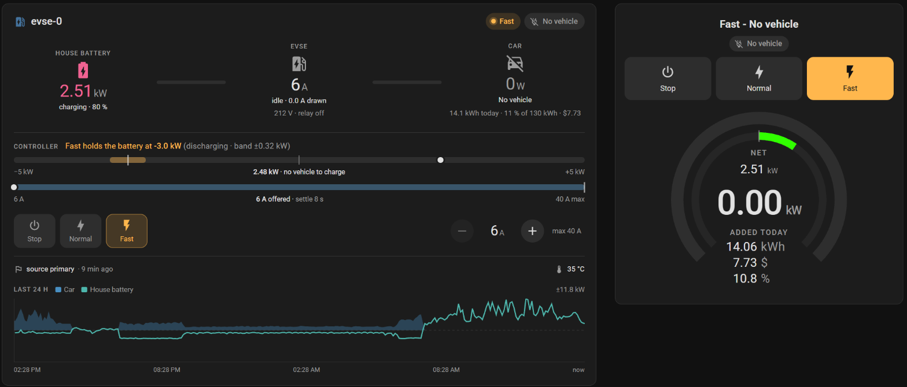
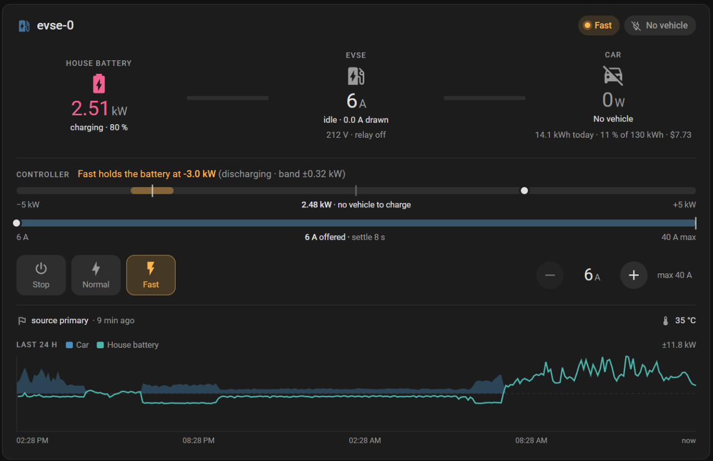
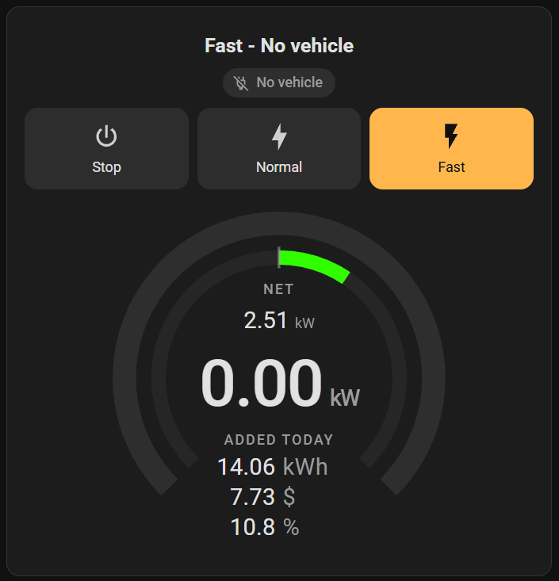

# esphome-evse

EVSE running entirely on an ESP32-S3 in ESPHome YAML, with a charge controller that follows a
house battery through Home Assistant.

BETA firmware. Use at your own risk. No RCD.



## Charge modes

| Mode | What it does |
| --- | --- |
| Stop | Pilot off. |
| Manual | Offers Current Setpoint to the car. |
| Normal | Holds the house battery at Normal Target (default −1 kW, about 1 kW of discharge). With PV surplus the car ramps up to Max Current Limit; at night it sits at 6 A. |
| Fast | Holds Fast Target (default −3 kW). If the battery is still over target with the car at 6 A for a minute, it pauses, and restarts once there's room again. |

The controller steps the offered current every few seconds, sized to the error, and leaves it alone
while the battery is within ±1.5 A worth of power of the target, so it doesn't hunt. Setting a
current by hand (HA or LCD) just gives it a new starting point.

Protection:

- **House SOC:** charging stops at Battery Target Min SOC (default 20 %) and starts again at 21 %.
  From 30 % down to 20 % the current limit tapers to 6 A. With two batteries the lower SOC counts.
- **Low voltage:** below Battery Low Voltage Cutoff for 30 s latches a lockout (0 V turns it off).
  Turning Charger Enabled back on clears it once the voltage has recovered.
- **Lost battery data:** if an input stops updating for 30 s the fallback input takes over. With no
  input at all the current is held, never raised, and drops to 6 A after 10 minutes.

## Home Assistant cards

[esphome-evse-card](https://github.com/clowrey/esphome-evse-card) (HACS) has two cards:

| Advanced | Simple |
| --- | --- |
|  |  |
| Battery → EVSE → car flow, where the battery sits against the controller's target band, controls, last event, 24 h chart. | Status, Stop / Normal / Fast, and a gauge with charger power, battery power and today's energy. |

```yaml
type: custom:esphome-evse-card        # or custom:esphome-evse-simple-card
prefix: evse_0
```

`dashboard-evse.yaml` is an older dashboard built from flex-horseshoe and Mushroom cards instead.

## Setup

A device file sets the name, Wi-Fi, API, OTA and the substitutions below, and pulls the rest from
this repo. Start from `esphome-evse.yaml`:

```yaml
substitutions:
  name: evse-0
  firmware_ref: main
  ha_battery_power_id: sensor.battery_power
  ha_battery_power_divisor: "1000.0"   # W -> kW; use "1" if the sensor is already kW

packages:
  s3_evse:
    url: https://github.com/clowrey/esphome-evse.git
    ref: ${firmware_ref}
    files:
      - packages/s3-evse.yaml
    refresh: 0s
```

`secrets.yaml` needs `wifi_ssid`, `wifi_password`, `ota_password` and `api_encryption_key`.

Substitutions (anything left out uses the package default; "first boot" values are saved on the
device after that and changed there):

| Substitution | |
| --- | --- |
| `name` | Hostname, e.g. `evse-0`. Entity ids use it with `_` for `-` (`sensor.evse_0_power`). |
| `firmware_ref` | Branch or tag of this repo to build from. `components_source` follows it; set that to `../esphome-evse/components` to build from a local checkout. |
| `ha_battery_power_id` | House battery power, signed: + charging, − discharging. |
| `ha_battery_power_2_enabled`, `_2_id` | `1` adds a second power sensor, summed with the first (one per battery). |
| `ha_battery_power_fallback_enabled`, `_fallback_id` | `1` adds a slower sensor used while one of the above is stale. |
| `ha_battery_power_divisor` | `1000` for W, `1` for kW. Applies to all power sensors. |
| `ha_battery_voltage_id` | House battery voltage, for the low-voltage lockout. |
| `ha_battery_soc_id` | House battery SOC. |
| `ha_battery_2_enabled`, `ha_battery_2_soc_id` | `1` adds a second battery's SOC. |
| `battery_low_voltage_cutoff_initial` | First boot: lockout voltage (default 47, 0 = off). |
| `line_voltage_nominal` | Supply voltage used if the EVSE's own reading is missing (default 230). |
| `current_cal_0` … `current_cal_4` | CT clamp calibration, `raw -> amps`. |
| `max_current_initial` | First boot: Max Current Limit, the ceiling the controller works under. 6 A is the floor (5 A read as 0 A on a Leaf). |
| `normal_setpoint_a`, `fast_setpoint_a` | Current the LCD's Normal / Fast buttons start from. The HA buttons only change mode. |
| `electricity_cost_initial` | First boot: price per kWh for the daily cost. |
| `car_battery_kwh_initial` | First boot: car battery size, for "% added today". |

The controller's tuning is in the `Charge Control …` numbers on the device. `Event Flag` logs each
thing it does, `Battery Power Source` shows which input it's using, and `HA Inputs Debug` dumps
everything it sees on one line.

## Code

- `packages/s3-evse.yaml` – entry point. Includes `packages/s3/` board, cp-pilot, metering,
  charge-control and lcd.
- `components/evse_cp` – control pilot state machine.
- `components/evse_charge_control` – the charge controller. `charge_controller.cpp` has no ESPHome
  dependencies; `test/charge_control` runs it against recorded HA data (`build.sh` in Linux/WSL).

Upgrading from the old single-file package: the `PV Auto …` numbers, `Auto Mode` switch and
`HA Battery … Read` sensors are gone (delete them in HA), and `HA Battery Power` now reports kW.
The tag `legacy-pv-auto` is the last build before the change.

## Hardware

LCD


[Post in the ESPHome Discord "Show Off" Channel](https://discord.com/channels/429907082951524364/1308643575449518160) 


[Inspired by this great ESP32 (not ESPHome) project!](https://github.com/dzurikmiroslav/esp32-evse) 

[Miroslav Dzúrik explains the CP protocol and hardware to generate it in depth on his Wiki here.](https://github.com/dzurikmiroslav/esp32-evse/wiki/CP-calibration)


Charging real car at 40A - current setpoint can be changed in real time and vehicle will adjust its draw.


PCB Designed by me - produced by JLCPCB


